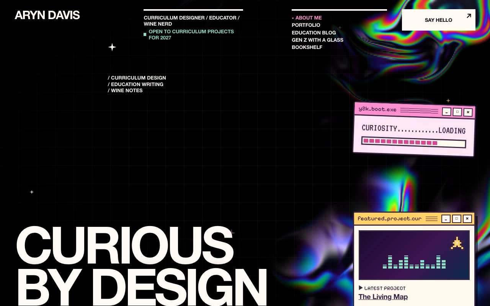
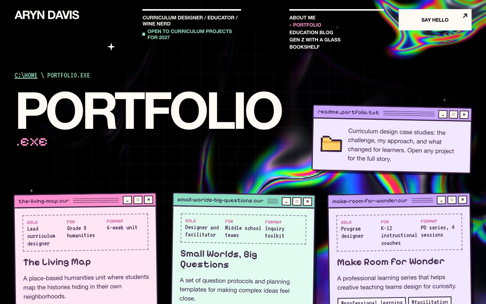
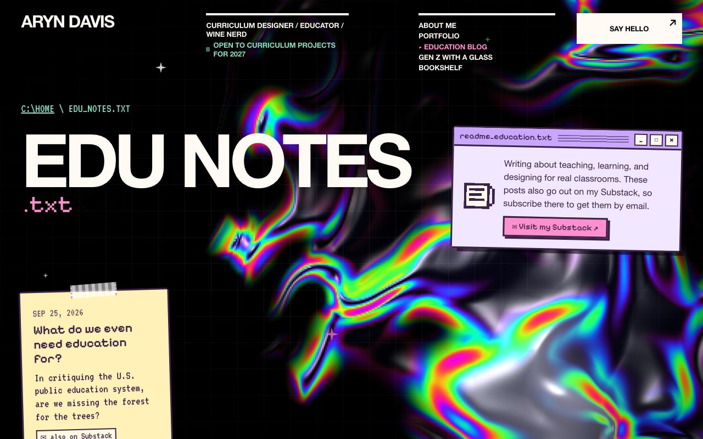
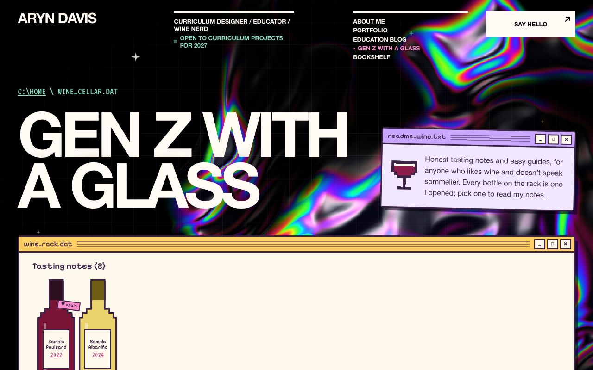
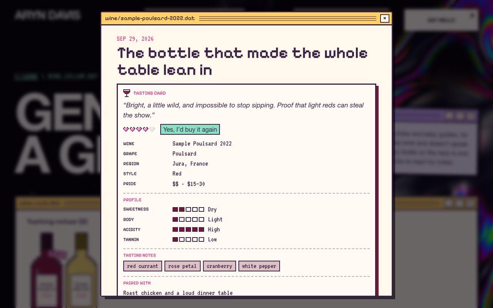
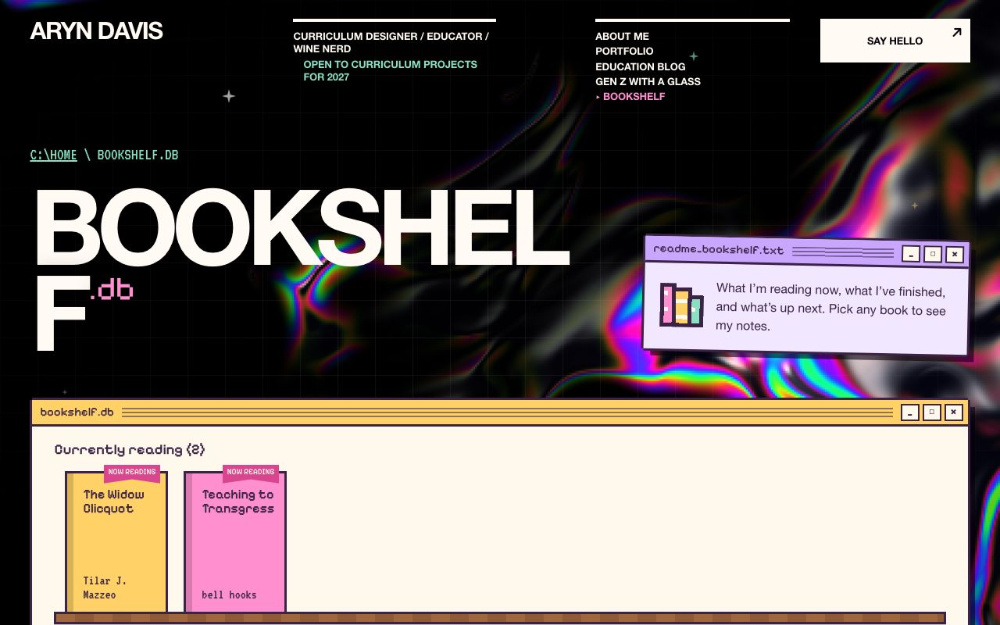

# Personal website

Aryn Davis's personal site: an about-me home page, a curriculum design portfolio, an education blog, and a wine blog. It has a Y2K desktop look: a liquid-chrome holographic background with pixel pop-up windows and post-it notes. Built with React, TypeScript, and Vite.

## Screenshots

Taken from the production build at 1280×800. Update them whenever a page's look changes (they live in `docs/screenshots/`).

| Home (about me) | Portfolio |
| --- | --- |
|  |  |
| **Education blog** | **Gen Z With A Glass (wine blog)** |
|  |  |
| **Tasting card** | **Bookshelf** |
|  |  |

## Run locally

Requires Node.js LTS and npm (with nvm: `nvm install --lts && nvm use --lts`).

```sh
npm install
npm run dev       # live preview at http://localhost:5173
npm run build     # type-check and build to dist/
npm run preview   # serve the production build at http://localhost:4173
npm test          # content and Substack-sync tests
```

## Pages

| URL | Page | Content file |
| --- | --- | --- |
| `#/` | About me (home) | `src/pages/Home.tsx` |
| `#/portfolio` | Curriculum portfolio | `src/content/portfolio.ts` |
| `#/education` | Education blog | `src/content/education.ts` |
| `#/wine` | Gen Z With A Glass (wine blog) | `src/content/wine.ts` |
| `#/bookshelf` | Bookshelf (reading list) | `src/content/books.ts` |

Every project and post has its own link (for example `#/wine/weeknight-white-under-20`). Opening it shows the entry in a pop-up window, and each section also has a plain `index.txt` list of links. Routes use the `#/` form so the site works on any static host without server rewrite rules.

## Editing content

- **Name, email, tagline:** `src/site.ts`
- **About me text:** `src/pages/Home.tsx`
- **Projects and posts:** add an object to the array in the matching `src/content/*.ts` file. Bodies are lists of blocks (`p`, `h`, `list`, `quote`); see `src/content/types.ts`. Content is rendered as text, never as raw HTML.
- **Books:** add or move books in `src/content/books.ts`. Set `status` to `'reading'` (shown face-out and on the home page's currently.txt), `'read'` or `'want'`, and pick a spine `color`. `rating` and `note` are optional.
- **Wine posts (Gen Z With A Glass)** come in two kinds, both in `src/content/wine.ts`:
  - **Tasting notes** show as pixel bottles on a wine rack, colored by style. Only four fields are required:

    ```ts
    { wine: 'Domaine Example Poulsard', grape: 'Poulsard', vintage: 2022, date: '2026-10-20' },
    ```

    The title, link (`#/wine/domaine-example-poulsard-2022`), tags and layout are made for you, and the style (red, white, rosé, orange, sparkling, dessert) is guessed from the grape and name. Optional extras fill in the tasting card and the post:
    - **Card basics:** `producer`, `region`, `price` (`'$'` to `'$$$$'`), `rating` (1–5 hearts), `buyAgain` (`'yes' | 'maybe' | 'no'`), `style`.
    - **Review:** `verdict` (a one-line review at the top of the card), `flavors` (tasting notes, e.g. `'red currant, rose petal'`).
    - **Profile meters:** `sweetness` (bone dry → sweet), `body` (light → full), `acidity` and `tannin` (low → high). Sweetness is guessed for reds, orange and dessert wines if left out.
    - **Pairings:** `pairedWith` (what you ate). Without it, the card shows "Try it with" suggestions from the grape or style, or your own `suggestedPairings`.
    - **The post:** `moment`, `look`, `nose`, `palate`, `finish`, `thoughts`. See `src/content/tastingNotes.ts`.
  - **Guides** show as pinned recipe cards and are written like any other post, with `kind: 'guide'`.
- **Links and italics** go inside a paragraph as a list of parts: `text: ['Read ', { text: 'this', href: 'https://…' }, ' and ', { text: 'that', em: true }]`. Only `http(s)` links become clickable.
- **Images** are `{ type: 'image', src: 'images/…/file.jpg', alt: '…' }`, with the file saved in `public/images/`. Images must live in this repo; the security policy blocks images from other sites.

### Education blog ↔ Substack

The education blog mirrors [arynlynn.substack.com](https://arynlynn.substack.com), and one command copies new posts over:

- `npm run sync:substack` downloads every free, public post into `src/content/education.substack.ts` and its images into `public/images/education/substack/`. Substack's HTML is converted into the typed blocks above (paragraphs with links and italics, headings, lists, quotes, images); subscribe boxes, buttons and embeds are dropped, and nothing is rendered as HTML.
- After publishing on Substack, run it, then commit and push the changes so the host redeploys:

  ```sh
  npm run sync:substack
  git add src/content/education.substack.ts public/images/education/substack
  git commit -m "Sync education posts from Substack" && git push
  ```

  It runs from your computer rather than on a schedule in GitHub Actions, because Substack refuses requests from GitHub's servers.
- Each synced post gets a "Read & subscribe on Substack" button and an "also on Substack" tag.
- Substack usually leaves image alt text empty, so synced images fall back to the caption or "Image from “Post title”". To polish a post, copy it from `education.substack.ts` into `src/content/education.ts` and edit it there: a hand-written post wins over a synced post with the same slug.
- Paid-only posts, podcasts and threads aren't synced.
- `npm run test:substack` checks the HTML conversion.

All sample content is placeholder text; replace it before publishing.

## Design pieces

- `src/components/HoloBackground.tsx`: animated WebGL liquid-chrome background. It pauses when the tab is hidden, shows a still frame for reduced-motion users, and falls back to CSS gradients without WebGL.
- `src/components/PixelWindow.tsx`: the pixel window frame. On the home page, windows can be dragged by their title bars (desktop with a mouse), minimized, and closed.
- `src/components/PixelIcon.tsx`: pixel-art icons drawn from small character grids.
- Fonts (Pixelify Sans, VT323) are bundled from npm via Fontsource, so nothing loads from a third party.

## Security

- The Content Security Policy only allows scripts, styles, fonts, and images from the site itself. No third-party scripts, no inline scripts, no framing, and forms are disabled. Assets are never inlined as `data:` URIs.
- `vite.config.ts` sends these headers from the dev and preview servers. `public/_headers` carries the same headers for hosts that support that file (Netlify, Cloudflare Pages). For other hosts, set equivalent headers in the host's settings. Keep the two files in sync.
- Serve production over HTTPS. Only add `includeSubDomains` or `preload` to HSTS if every subdomain is HTTPS-ready.
- Run `npm audit` periodically and keep `package-lock.json` committed.
